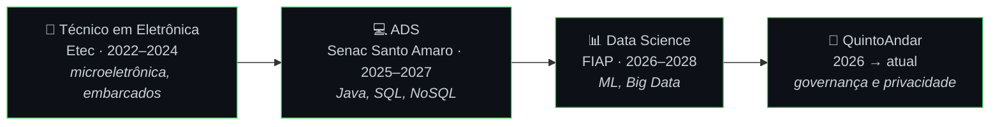

<div align="center">

<a href="https://github.com/ogsantss">
  
</a>

<br>

[](https://www.linkedin.com/in/gabrielsouza7/)
[](mailto:contact.gabriels7@gmail.com)


</div>

```sql
SELECT * FROM perfil WHERE github = 'ogsantss';
```
```text
+-------------+---------------------------------------------------------+
| campo       | valor                                                   |
+-------------+---------------------------------------------------------+
| nome        | Gabriel Souza                                           |
| cargo       | Jovem Aprendiz · Data Governance & Privacidade de Dados |
| empresa     | QuintoAndar (jan/2026 → atual)                          |
| foco        | Análise de Dados · Ciência de Dados · Governança        |
| estudando   | Data Science @ FIAP · ADS @ Senac                       |
| objetivo    | unir governança, privacidade e modelagem preditiva      |
+-------------+---------------------------------------------------------+
1 row in set (0.00 sec)
```

## 🏢 Experiência

**Jovem Aprendiz · Data Governance e Privacidade de Dados** — *QuintoAndar* · `jan/2026 → atual`

- 🔍 Análise, tratamento e qualidade de dados em processos de governança e privacidade (**LGPD**)
- 📊 Dashboards para acompanhar os indicadores da área
- ⚙️ Automação de processos e rotinas operacionais
- 💳 Execução e controle de pagamentos via **SAP**
- 🗺️ Mapeamento e documentação de processos com fluxogramas no **Figma**

## 🧪 Projetos

<table>
<tr>
<td width="50%" valign="top">

### 🏙️ [Radar Urbano](https://github.com/ogsantss/Radar-Urbano)
<sub>`em andamento`</sub>

Sistema web que indica as rotas mais seguras e eficientes da cidade usando **Machine Learning**, com dashboards de áreas de risco e um **LLM** que classifica as ocorrências relatadas pelos usuários.

`Python` `ML` `LLM` `BI` `Geoespacial`

</td>
<td width="50%" valign="top">

### 🚆 Challenge FIAP + Motiva
<sub>`acadêmico · em andamento`</sub>

Modelo preditivo para detectar com antecedência falhas em equipamentos que operam nos trilhos de trem de São Paulo. Dados de sensores, engenharia de features e foco em reduzir paradas não programadas.

`Python` `Classificação` `Manutenção preditiva`

</td>
</tr>
<tr>
<td width="50%" valign="top">

### 🛡️ Detecção de Vazamento de Dados
<sub>`pessoal · em andamento`</sub>

Identifica possíveis vazamentos de dados corporativos com **detecção de anomalias**. Auditoria de acessos com MongoDB + SQL, pipeline em Python e monitoramento no Power BI, aplicando conceitos da LGPD.

`Python` `MongoDB` `SQL` `Power BI` `LGPD`

</td>
<td width="50%" valign="top">

### ⚽ [Análise Copa do Mundo 2026](https://github.com/ogsantss/AnaliseCopaDoMundo)
<sub>`pessoal`</sub>

Análise exploratória de um dataset público com Pandas: tratamento, visualizações e geração de insights.

`Python` `Pandas` `Jupyter`

<br>

### 👟 E-commerce de Tênis
<sub>`acadêmico`</sub>

Site de vendas full stack com consumo de API, banco relacional e manipulação de JSON.

`API` `SQL` `JSON`

</td>
</tr>
</table>

## 🎓 Trajetória



## 🧰 Stack

<div align="center">


<br>


<br><br>


`Machine Learning` · `Modelagem Preditiva` · `Detecção de Anomalias` · `EDA` · `LLM` · `Big Data` · `Modelagem de Dados` · `Governança de Dados` · `LGPD`

</div>

## 📈 Atividade

<div align="center">


<br><br>

<picture>
  <source media="(prefers-color-scheme: dark)" srcset="https://raw.githubusercontent.com/ogsantss/ogsantss/output/github-snake-dark.svg" />
  <source media="(prefers-color-scheme: light)" srcset="https://raw.githubusercontent.com/ogsantss/ogsantss/output/github-snake.svg" />
  
</picture>

</div>

---

<div align="center">

<sub>📊 <code>dados.tratar().analisar().proteger()</code> 🔒</sub>

</div>
