

  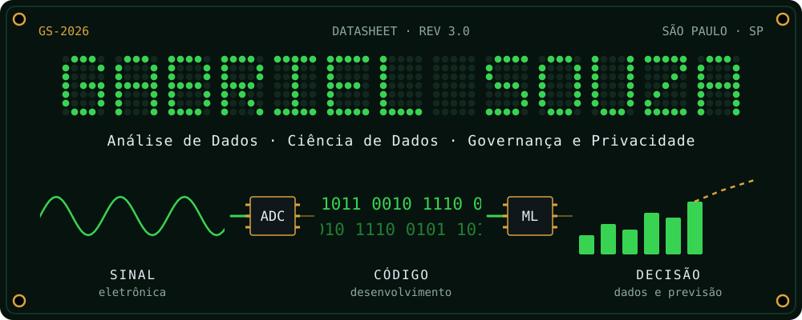

  <a href="https://www.linkedin.com/in/gabrielsouza7/">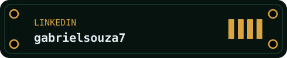</a>
  <a href="mailto:contact.gabriels7@gmail.com">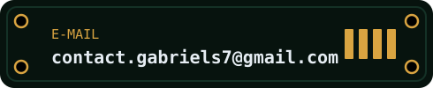</a>

## 1 · Descrição geral

  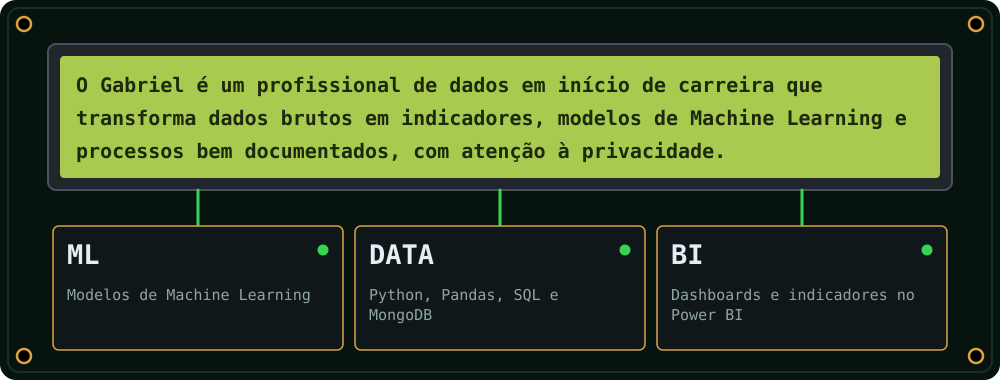

## 2 · Pinagem

  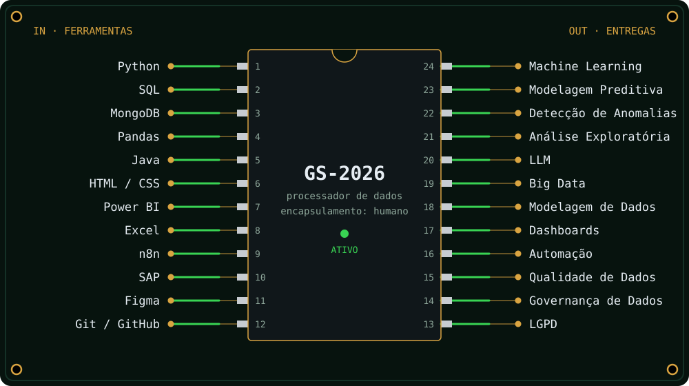

## 3 · Diagrama de blocos

  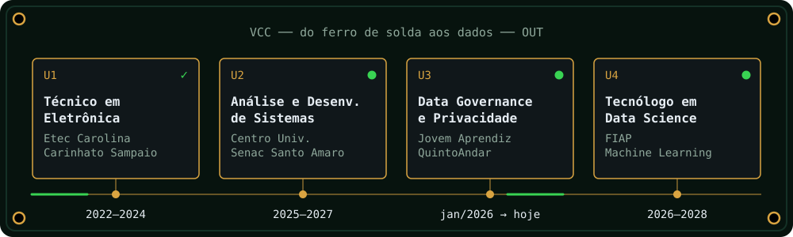

## 4 · Condições de operação

  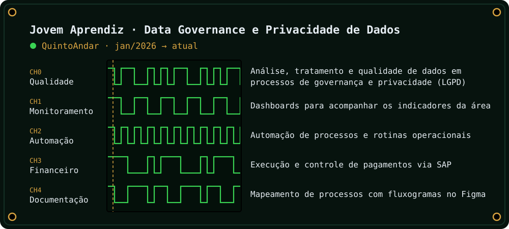

## 5 · Sinal medido

Medição real, não ilustração. Este traço é redesenhado todo dia com as minhas contribuições no GitHub.

  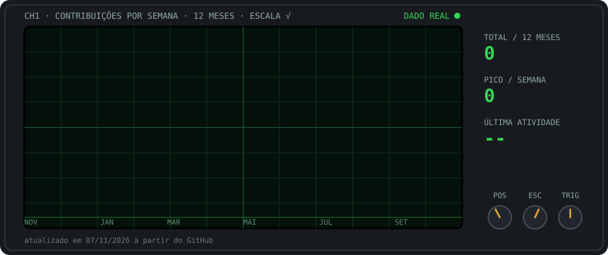
    
  <picture>
    <source media="(prefers-color-scheme: dark)" srcset="https://raw.githubusercontent.com/ogsantss/ogsantss/output/github-snake-dark.svg" />
    <source media="(prefers-color-scheme: light)" srcset="https://raw.githubusercontent.com/ogsantss/ogsantss/output/github-snake.svg" />
    
  </picture>

## 6 · Aplicações típicas

  <a href="https://github.com/ogsantss/Radar-Urbano">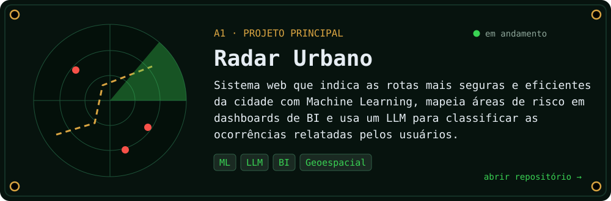</a>
    
  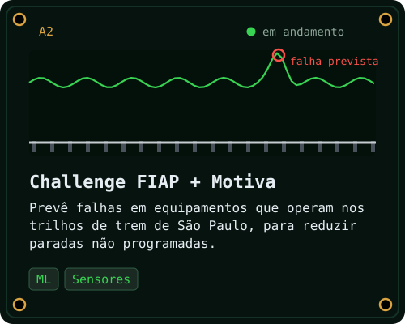
  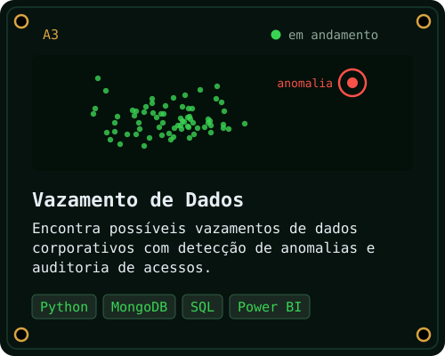

## 7 · Informações para contato

  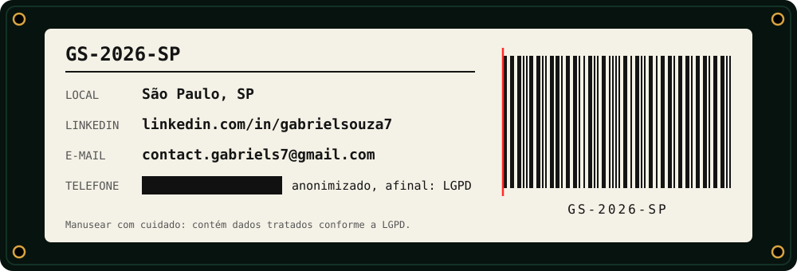

<b>📄 Abrir a versão em texto</b> (melhor para ler no celular)

### Sobre

Profissional de dados em início de carreira. Transformo dados brutos em indicadores, análises e processos bem documentados, com atenção à privacidade.

### Experiência

**Jovem Aprendiz · Data Governance e Privacidade de Dados** · QuintoAndar · jan/2026 → atual

- Análise, tratamento e qualidade de dados em processos de governança e privacidade (LGPD)
- Dashboards para acompanhar os indicadores da área
- Automação de processos e rotinas operacionais
- Execução e controle de pagamentos via SAP
- Mapeamento de processos com fluxogramas no Figma

### Projetos

- **[Radar Urbano](https://github.com/ogsantss/Radar-Urbano)**: rotas seguras com Machine Learning, BI e LLM (em andamento)
- **Challenge FIAP + Motiva**: previsão de falhas em equipamentos dos trilhos de trem de São Paulo (em andamento)
- **Detecção de Vazamento de Dados**: detecção de anomalias e auditoria de acessos com Python, MongoDB, SQL e Power BI (em andamento)

### Formação

- Tecnólogo em Data Science · FIAP · 2026–2028 (em andamento)
- Tecnólogo em Análise e Desenvolvimento de Sistemas · Senac Santo Amaro · 2025–2027 (em andamento)
- Técnico em Eletrônica · Etec Carolina Carinhato Sampaio · 2022–2024

### Habilidades

Python, SQL, Java · Tratamento de Dados, Análise Exploratória, Pandas · MongoDB, Modelagem de Dados · Power BI, Excel · Git, GitHub, APIs, JSON · Privacidade de Dados, LGPD

